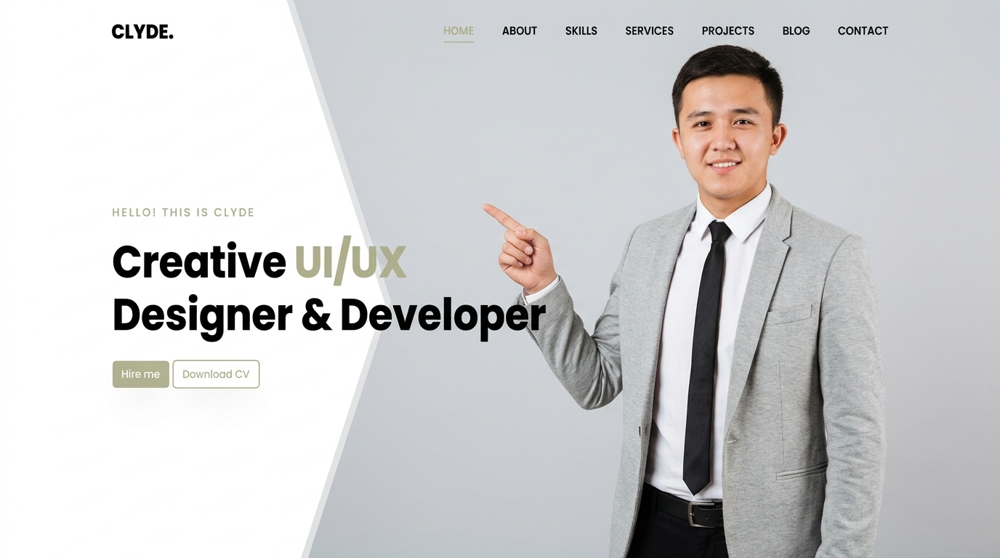

# 🌟 SAIDABRORXON. — Personal Portfolio Website

Modern, minimalist va to'liq moslashuvchan (responsive) shaxsiy portfolio veb-sayti.



## 👤 Muallif
**Ubaydullayev Saidabrorxon** — Kreativ UI/UX Dizayner va Frontend Veb Dasturchi.

---

## 🚀 Texnologiyalar Steki
- **Frontend Core**: React 19 + Vite 8
- **Styling**: Tailwind CSS v4 + Maxsus CSS3 animatsiyalari
- **Ikonkalar**: Lucide React
- **Tipografiya**: Google Fonts (Poppins, Plus Jakarta Sans)
- **Til qo'llab-quvvatlashi**: O'zbek tili (birlamchi) va Ingliz tili (UZ / EN)

---

## ✨ Asosiy Imkoniyatlar
- **Hero Section**: 
  - Toza oq va kulrang fotostudiya foni o'rtasidagi diagonal geometrik ajratuvchi chiziq.
  - Sifatli portret fotosurati (Harbiy libos va Dizayner qiyofasi o'rtasida almashtirish tugmasi).
  - `#B1B394` zaytun-yashil muted rang aksentlari.
  - "Hamkorlik qilish" va "CV yuklab olish" interaktiv tugmalari.
- **Men haqimda (About)**: To'liq bio, dizayn tamoyillari, statistik ko'rsatkichlar.
- **Ko'nikmalar (Skills)**: UI/UX dizayn (Figma, Prototyping, Heuristics) va Veb dasturlash (React, Tailwind, JS, TS) bo'yicha saralovchi filtrlar va foizli indikatorlar.
- **Xizmatlar (Services)**: UI/UX, Veb dasturlash, Mobil ilovalar dizayni va Dizayn tizimlari.
- **Loyihalar (Projects)**: 
  - *Dunyoning Mo'jizaviy Maskanlari* — JavaScript Carousel Showcase.
  - *Sneakers* — Fall Limited Edition E-Commerce mahsulot vitrinasi.
  - *Rejalarim* — Smart To-Do List (Glassmorphism & Dark Mode).
  - Har bir loyiha uchun to'liq tahliliy Case Study modali.
- **Blog**: Dizayn ierarxiyasi, dizayn tizimlari va mikro-animatsiyalar haqida maqolalar.
- **Aloqa (Contact)**: Validatsiyaga ega to'liq ishlaydigan xabar yuborish formasi.
- **CV Modal**: To'liq rezyume ko'rinishi, chop etish va yuklab olish imkoniyati.

---

## 💻 Loyihani Mahalliy Muhitda Ishga Tushirish

1. **Repozitoriyani yuklab oling (Clone):**
   ```bash
   git clone https://github.com/abbos756756-code/Portfolio.git
   cd Portfolio
   ```

2. **Kutubxonalarni o'rnating:**
   ```bash
   npm install
   ```

3. **Dasturni ishga tushiring:**
   ```bash
   npm run dev
   ```

4. Brauzerda oching:
   ```
   http://localhost:5173
   ```

5. **Ishlab chiqarish (Production) uchun build qilish:**
   ```bash
   npm run build
   ```

---

## 📄 Litsenziya
Ushbu loyiha shaxsiy portfolio sifatida yaratilgan. Barcha huquqlar himoyalangan.
